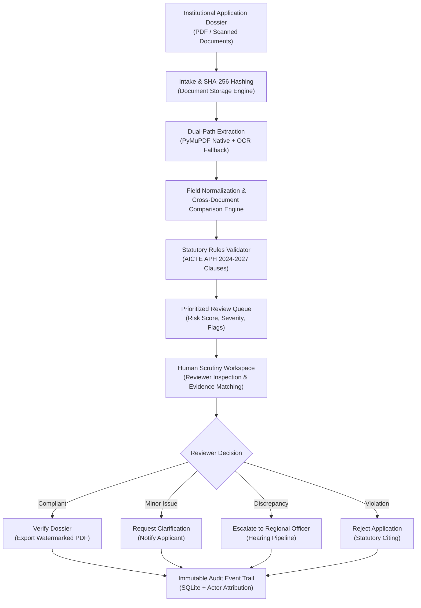

# AICTE VerifyAI

> **Smart India Hackathon (SIH 2026) | Problem Statement SIH26261**  
> **Automated Scrutiny & Cross-Document Verification Platform for AICTE Technical Institution Approvals**  
> *Grounded in AICTE Approval Process Handbook (APH 2024–2027) Statutory Norms*

---

## 📌 Executive Summary

Every academic year, thousands of technical institutions across India submit comprehensive approval dossiers to the **All India Council for Technical Education (AICTE)** seeking Extension of Approval (EoA), new program introductions, intake expansions, or campus variations. A single institutional filing regularly spans dozens of complex legal, administrative, and infrastructural instruments—including registered land deeds, encumbrance certificates, municipal land use NOCs, approved building plans, fire safety certificates, and faculty cadre registers.

Manual verification of these submissions presents severe systemic challenges:
- **High cognitive load and review delays:** Scrutiny committees must manually cross-check hundreds of tabular and textual data points across separate instruments.
- **Cross-document discrepancies:** Subtle mismatches in trust nomenclature, survey numbers, contiguous land area hectares vs. acres, built-up carpet areas, and validity dates frequently slip past manual inspection.
- **Data integrity and auditability:** Institutional scrutiny requires a strictly auditable, tamper-evident trail separating objective public registry data from applicant claims and official scrutiny decisions.

**AICTE VerifyAI** solves this challenge by delivering an **AI-powered, human-in-the-loop regulatory intelligence workspace**. The platform automates document intake, text/structural extraction, statutory rule validation, and cross-instrument reconciliation, while keeping final decisions firmly in the hands of authorized AICTE scrutiny officers with complete cryptographic audit logging.

---

## 🏛️ Regulatory Grounding: AICTE APH 2024–2027

AICTE VerifyAI hardcodes no arbitrary heuristics. All validation rules and compliance checks directly cite the official **AICTE Approval Process Handbook (APH) 2024–2027**:

| Regulation / Clause | Scrutiny Scope | Platform Verification Engine |
|---|---|---|
| **APH §6.17 & Annexure 1** | Land Norms & Ownership | Cross-checks Land Title Deed, Non-Encumbrance Certificate, and Land Conversion Order for continuous unencumbered title, correct survey/khasra numbers, and required acreage. |
| **APH §6.14 & Cadre Norms** | Faculty Cadre Ratios | Analyzes faculty lists for statutory Professor : Associate Professor : Assistant Professor (1:2:6) ratio and Student-to-Faculty Ratio (SFR 1:15 / 1:20). |
| **APH §6.16 & NBC Part 4** | Fire Safety & Structural Soundness | Validates municipal Fire Safety NOC validity windows, competent authority seal, and structural stability certifications. |
| **APH §6.19 & Annexure 4** | Built-up Area & Facilities | Verifies approved building completion plans for instructional carpet area, laboratories, administrative space, and computer center mandates. |
| **APH Chapter VII** | Statutory Penalties & Redressal | Flags severe or unresolvable discrepancies for escalation to the Regional Officer or Hearing Committee. |

---

## ✨ Key Features & Implemented Capabilities

### 1. Multi-Stage Document Intake & Field Extraction
- **Native Vector PDF & OCR Pipeline:** Extracts text and metadata using high-precision native parsing (**PyMuPDF / Fitz**) with fallback to **Tesseract OCR** for scanned instruments.
- **Multi-File Reconciler:** Accepts uploads for Land Title Deeds, Land Use Certificates, Fire NOCs, Building Plans, and Faculty Rolls, performing automatic SHA-256 fingerprinting on intake.
- **Field Normalization:** Handles diverse date formats (DD/MM/YYYY, ISO, text), land measurement units (acres, square meters, hectares, cents, guntas), and trust naming variations.

### 2. Cross-Document Reconciliation Engine
- Automatically correlates field values across distinct uploaded instruments (e.g., matching the land parcel surveyed in the Title Deed against the parcel cited in the municipal Non-Encumbrance Certificate).
- Classifies comparison outcomes into four discrete states:
  - `MATCH`: Values align within statutory tolerance thresholds.
  - `MISMATCH`: Direct contradiction identified between institutional records.
  - `NEEDS_REVIEW`: Ambiguous formulation, partial name match, or borderline variance requiring human inspection.
  - `MISSING`: Required regulatory instrument or mandatory clause absent from the dossier.

### 3. Authorized Human-in-the-Loop Review Workspace
- **Zero Automated Sanctions:** AI suggestions highlight evidence and cite clauses; official decisions (*Verify Dossier*, *Request Clarification*, *Escalate to Regional Officer*, *Reject*) require reviewer authorization.
- **Institutional Scrutiny Dossier Modal:** Comprehensive scrutiny interface featuring Reference Provenance, Statutory Checkpoints, Reviewer Action Workbench, Case Notes, and Audit History.
- **Official Watermarked Dossier PDF Export:** Instant client-side generation of an official Institutional Verification Summary Report with AICTE Permanent ID, AISHE code, SHA-256 integrity hash, and regulatory watermark.

### 4. Dual-Dataset Architecture & Real/Synthetic Isolation
- **Dataset Isolation Policy:** To prevent false compliance claims, the system strictly separates synthetic demo submissions from authentic public reference data.
- **Synthetic Demo Dataset (30 Submissions):** Pre-seeded with realistic institutional profiles and 21 statutory findings for testing and committee demonstration.
- **Public Reference Directory (10 Premier HEIs):** Real, immutable institutional baseline records (PSG College of Technology, COEP Pune, Delhi Technological University, BMS College of Engineering, etc.) imported from official AICTE and AISHE public registries with authentic permanent IDs.
- **Universal Dataset Toggle:** Both Overview and Analytics pages feature independent **Synthetic Data / Real Data** toggles backed dynamically by SQLite.

### 5. Dynamic Evaluation Centre
- Built-in empirical benchmarking harness evaluating system precision against ground truth.
- Interactive 4×4 confusion matrix supporting one-click cell filtering and detailed drill-down into contributing test case records.

### 6. Cherry Blossom Noir Design System
- Custom high-contrast executive dark UI engineered for prolonged reviewer focus.
- Palette: Plum Noir (`#351D31`), Cherry Blossom (`#8A2F5B`), Rose Vivid (`#C14E83`), Snow Pure (`#FFFAFC`).
- Accessible keyboard navigation, smooth sequential SVG chart animations, and responsive layouts.

---

## 🔄 End-to-End Scrutiny Workflow



---

## 📊 Evaluation Centre & Empirical Benchmark Results

The Evaluation Centre provides a transparent, verifiable evaluation testbed to measure classification accuracy, recall, and edge-case resilience against labeled ground-truth files.

> ⚠️ **Methodology Note:** These metrics reflect empirical performance across our curated **24-case benchmark suite** designed specifically to stress-test boundary conditions, OCR degradations, and nomenclature variations. They are not a claim of universal real-world accuracy across arbitrary third-party inputs.

### Curated Benchmark Categories (24 Cases)

1. **Category 1: Clean Vector PDFs (6 cases):** Machine-readable PDFs testing standard land title deeds, built-up area schedules, and fire certificates.
2. **Category 2: Multi-Unit Land Calculations (6 cases):** Conversion across acres, hectares, cents, and guntas to verify §6.17 continuous land thresholds.
3. **Category 3: Cross-Document Discrepancies (6 cases):** Deliberate contradictions between Title Deeds, Encumbrance Certificates, and Town Planning Approvals.
4. **Category 4: Scanned & OCR Pre-processing (6 cases):** Low-DPI scans, skewed stamps, degraded handwriting, and blank container pages.

### Dynamic Metric Summary

```text
========================================================================================
AICTE VERIFYAI — BENCHMARK EVALUATION SUMMARY (Curated 24-Case Testbed)
========================================================================================
Total Test Cases:               24
Overall Accuracy:               87.5% (21/24 cases exactly classified)
Macro-Averaged F1 Score:        0.826
Discrepancy Detection Rate:     91.7% (11 of 12 true defects/anomalies detected)
Mean Execution Latency:         42 ms (Dynamic evaluation runner)
----------------------------------------------------------------------------------------
Class Performance Breakdown:
  • MATCH:         Precision: 0.909 | Recall: 1.000 | F1: 0.952 (10 true cases)
  • MISMATCH:      Precision: 0.857 | Recall: 1.000 | F1: 0.923 (6 true cases)
  • NEEDS_REVIEW:  Precision: 0.667 | Recall: 0.500 | F1: 0.571 (4 true cases)
  • MISSING:       Precision: 1.000 | Recall: 0.750 | F1: 0.857 (4 true cases)
========================================================================================
```

### Documented Boundary Cases (Off-Diagonal Matrix Cells)

Rather than artificially inflating benchmark scores to 100%, VerifyAI authentically surfaces edge cases to assist scrutiny officers:
- **`tc-reconcile-06` (Expected: `NEEDS_REVIEW`, Predicted: `MISMATCH`):** Slight trust nomenclature variance (*"Shri Balaji Educational Trust"* vs *"Sri Balaji Education Trust"*). Flagged as a mismatch due to strict legal trust title safety thresholds.
- **`tc-ocr-04` (Expected: `NEEDS_REVIEW`, Predicted: `MATCH`):** Heavy handwriting degradation on a municipal fire safety NOC. Native OCR extracted numeric registration while missing handwritten marginal reservations.
- **`tc-ocr-06` (Expected: `MISSING`, Predicted: `NEEDS_REVIEW`):** Blank single-page PDF container uploaded as an encumbrance certificate. Pipeline flagged the valid PDF container for review rather than classifying it as missing.

---

## 🛠️ Technology Stack

### Frontend Architecture
- **Framework:** [React 19.3](https://react.dev/) with [TypeScript 6.0](https://www.typescriptlang.org/)
- **Build Tool:** [Vite 8.3](https://vitejs.dev/) with Hot Module Replacement (HMR)
- **Styling:** [Tailwind CSS v4.3](https://tailwindcss.com/) with native CSS variables for Cherry Blossom Noir theme
- **Icons:** [Lucide React](https://lucide.dev/) (consistent UI glyphs)
- **Document Generation:** [jsPDF 4.2](https://parall.ax/products/jspdf) (client-side scrutiny report and watermark rendering)
- **Static Analysis:** [Oxlint 1.88](https://oxc.rs/) for high-speed AST verification

### Backend Architecture
- **Framework:** [FastAPI 0.104+](https://fastapi.tiangolo.com/) with [Pydantic v2](https://docs.pydantic.dev/) schemas
- **Server:** [Uvicorn 0.24+](https://www.uvicorn.org/) (ASGI high-concurrency server)
- **Database & ORM:** [SQLite 3](https://www.sqlite.org/) with [SQLAlchemy 2.0+](https://www.sqlalchemy.org/)
- **Document Extraction:** [PyMuPDF 1.23+ (Fitz)](https://pymupdf.readthedocs.io/) (vector text, layout analysis, PDF stream parsing)
- **OCR Engine:** [pytesseract 0.3+](https://github.com/madmaze/pytesseract) with [Pillow 10.0+](https://python-pillow.org/)
- **Authentication:** Google OAuth 2.0 / OpenID Connect with [google-auth 2.0+](https://github.com/googleapis/google-auth-library-python) and role allowlist gating
- **Testing:** [pytest 8.4+](https://docs.pytest.org/) and [pytest-asyncio](https://github.com/pytest-dev/pytest-asyncio)

---

## 📂 Project Directory Structure

```text
AICTE-VerifyAI/
├── .env.example               # Root environment configuration template
├── package.json               # Frontend dependencies, build & lint scripts
├── vite.config.ts             # Vite configuration with React & Tailwind plugins
├── tsconfig.json              # TypeScript project references
├── index.html                 # Single-page application root
│
├── backend/                   # Python FastAPI Backend
│   ├── .env.example           # Backend environment configuration template
│   ├── requirements.txt       # Production & test Python dependencies
│   ├── verifyai.db            # Local SQLite database (git-ignored)
│   ├── app/
│   │   ├── main.py            # FastAPI entry point, middleware, lifecycle events
│   │   ├── database.py        # SQLAlchemy engine, session factories, declarative base
│   │   ├── config.py          # Pydantic Settings configuration parser
│   │   ├── models.py          # SQLAlchemy models (Applications, Documents, Audit, etc.)
│   │   ├── schemas.py         # Pydantic validation schemas & DTOs
│   │   ├── routes/            # REST API endpoints
│   │   │   ├── applications.py   # Application CRUD, uploads, cross-doc checks
│   │   │   ├── audit.py          # Audit event querying and trail streaming
│   │   │   ├── auth.py           # Reviewer login, Google OAuth, token management
│   │   │   ├── compliance.py     # Rule evaluations and statutory findings
│   │   │   ├── dashboard.py      # Aggregate KPIs and activity feeds (mode-isolated)
│   │   │   ├── documents.py      # Document viewing and metadata retrieval
│   │   │   ├── evaluation.py     # Evaluation Centre trigger & matrix queries
│   │   │   ├── health.py         # System health, OCR engine & storage status
│   │   │   ├── reference_data.py # Public HEI directory, dossier workspace, actions
│   │   │   └── reviewer.py       # Reviewer action queue & case assignment
│   │   └── services/          # Core Business Logic & Algorithms
│   │       ├── cross_doc_engine.py    # Inter-instrument consistency engine
│   │       ├── dataset_importer.py    # Official AICTE & AISHE directory ingestion
│   │       ├── evaluation_runner.py   # Benchmark execution & confusion matrix generator
│   │       ├── field_extractor.py     # Regex & heuristic key field parsing
│   │       ├── file_storage.py        # Disk storage & SHA-256 verification
│   │       ├── ocr_service.py         # Tesseract OCR wrapper & image preprocessing
│   │       ├── pdf_extractor.py       # PyMuPDF native text & structural extractor
│   │       └── synthetic_seeder.py    # 30-case synthetic benchmark seeder
│   └── tests/                 # Automated Pytest Suite (192 passing tests)
│       ├── conftest.py
│       ├── test_analytics.py
│       ├── test_cross_doc.py
│       ├── test_dashboard.py
│       ├── test_dataset_pipeline.py
│       ├── test_evaluation_runner.py
│       ├── test_real_data_review.py
│       └── test_validation.py
│
├── src/                       # Frontend React Application
│   ├── main.tsx               # React root mount
│   ├── App.tsx                # Routing, active page switching, global toast/alerts
│   ├── index.css              # Cherry Blossom Noir theme variables & Tailwind rules
│   ├── pages/                 # Full-Page Review Workspaces
│   │   ├── ActionQueuePage.tsx        # Prioritized scrutiny task queue
│   │   ├── AnalyticsPage.tsx          # Sequential charts, trends, risk distributions
│   │   ├── ApplicationReviewWorkspacePage.tsx # Detailed case inspection & side-by-side docs
│   │   ├── AuditEventsPage.tsx        # Comprehensive tamper-evident audit log
│   │   ├── EvaluationPage.tsx         # Benchmark confusion matrix & case drill-down
│   │   ├── EvidenceSearchPage.tsx     # Semantic & keyword statutory evidence search
│   │   ├── OverviewPage.tsx           # Executive dashboard & public reference directory
│   │   └── PipelinePage.tsx           # Document ingestion & pipeline health monitoring
│   ├── components/            # Reusable UI Components
│   │   ├── common/            # Modals (InstitutionalReferenceDetailModal, DataSources)
│   │   ├── dashboard/         # Directory view, priority cards, KPI widgets
│   │   ├── layout/            # TopBar, LeftNav, Footer
│   │   ├── review/            # DocumentViewer, CrossDocComparisonView, NotesTimeline
│   │   └── ui/                # StatusBadge, SeverityBadge, MetricCard, Button
│   ├── services/
│   │   └── api.ts             # Strongly typed Axios/Fetch service layer
│   └── utils/
│       └── downloadHelpers.ts # Client-side watermarked PDF dossier generator
│
├── docs/                      # Architectural & Integration Documentation
│   ├── api-contract.md
│   └── frontend-backend-integration.md
└── scripts/
    └── test_urls.py           # Verification script for official reference endpoints
```

---

## ⚡ Installation & Setup Guide

### Prerequisites
- **Node.js:** v18.0.0 or higher (v20+ recommended)
- **Python:** v3.10, v3.11, v3.12, or v3.13
- **Git:** Latest version
- *(Optional)* **Tesseract OCR:** Installed on system PATH if performing OCR on scanned images (native PDF parsing is active out of the box).

---

### Step 1: Clone the Repository

```bash
git clone https://github.com/namithsinghk142-ctrl/AICTE-VerifyAI.git
cd AICTE-VerifyAI
```

---

### Step 2: Backend Environment & Setup

1. **Create and activate a Python virtual environment:**
   ```bash
   # Windows (PowerShell)
   python -m venv .venv
   .venv\Scripts\Activate.ps1

   # Linux / macOS
   python3 -m venv .venv
   source .venv/bin/activate
   ```

2. **Install backend dependencies:**
   ```bash
   pip install -r backend/requirements.txt
   ```

3. **Configure backend environment variables:**
   ```bash
   cp backend/.env.example backend/.env
   ```
   *Edit `backend/.env` if you wish to configure custom ports, database URLs, or Google OAuth keys.*

4. **Initialize database with pre-seeded datasets:**
   ```bash
   # Runs migrations, seeds 30 synthetic test cases, and imports 10 official reference HEIs
   python -m uvicorn app.main:app --app-dir backend --host 127.0.0.1 --port 8000
   ```
   *On initial startup, FastAPI automatically builds tables in `verifyai.db`, loads synthetic applications, and populates the public reference directory.*

---

### Step 3: Frontend Environment & Setup

1. **Install Node.js packages:**
   ```bash
   npm install
   ```

2. **Configure frontend environment variables:**
   ```bash
   cp .env.example .env
   ```
   *The default configuration targets `VITE_API_BASE_URL=http://localhost:8000/api/v1`.*

3. **Start the Vite development server:**
   ```bash
   npm run dev -- --port 5173
   ```

4. **Access the Application:**
   - **Frontend UI:** [http://127.0.0.1:5173/](http://127.0.0.1:5173/)
   - **Backend API:** [http://127.0.0.1:8000/](http://127.0.0.1:8000/)
   - **Interactive Swagger Docs:** [http://127.0.0.1:8000/docs](http://127.0.0.1:8000/docs)

---

## 🔐 Authentication & Reviewer Allowlist

AICTE VerifyAI enforces role-based access control. In development and review mode, authorized test accounts are pre-configured:

| Reviewer Role | Account Email | Password | Access Scope |
|---|---|---|---|
| **Lead Compliance Officer (SIH Judge Demo)** | `adhav.sri123@gmail.com` | `VerifyAI@Adhav123!` | Full scrutiny authority, dossier verification, escalation, and audit access (Pre-filled on login page) |
| **Review Officer** | `namithsceptile142@gmail.com` | `VerifyAI@Namith123!` | Scrutiny review, cross-document inspection, and clarification requests |

> **For SIH Judges:** When you visit the public website, Adhav's demo credentials (`adhav.sri123@gmail.com` / `VerifyAI@Adhav123!`) are pre-filled on the login page — click **Sign In** to immediately access the full reviewer workspace.

*Google OAuth 2.0 Sign-In is also supported when `GOOGLE_CLIENT_ID` and `VITE_GOOGLE_CLIENT_ID` are configured.*

---

## 🧪 Testing, Quality Assurance & Build Verification

The repository enforces strict continuous verification across backend test suites, frontend static analysis, and production build bundling:

### 1. Run Backend Automated Test Suite (192 Tests)
```bash
python -m pytest backend/tests/ -v
```
*Executes all unit, integration, and contract tests across analytics, cross-doc checks, evaluation runner, dataset isolation, and scrutiny lifecycles.*

### 2. Run Frontend Linter (Oxlint)
```bash
npm run lint
```
*Performs high-speed AST analysis across 82 TypeScript / React modules with zero errors.*

### 3. Build Production Bundle
```bash
npm run build
```
*Compiles TypeScript via `tsc -b` and bundles assets with Vite into `dist/`.*

---

## 🔒 Security, Data Governance & Ethical AI

1. **Data Minimization:** No Aadhaar numbers, personal phone numbers, or applicant banking credentials are required or persisted.
2. **Cryptographic Checksums:** Every uploaded document is fingerprinted on intake with **SHA-256** to prevent tampering or silent replacement.
3. **Immutable Audit Trails:** Every status transition, note creation, and scrutiny decision logs an immutable `AuditEvent` capturing actor, timestamp, and rationale.
4. **Human Agency:** Machine learning and heuristic parsers serve exclusively as decision-support aids. AICTE VerifyAI never issues automated approvals or rejections without human officer sign-off.

---

## 🗺️ Roadmap & Implementation Status

- [x] **Phase 1:** Core document ingestion pipeline & PyMuPDF text extraction.
- [x] **Phase 2:** Regulatory rule validator grounded in AICTE APH 2024–2027.
- [x] **Phase 3:** Cross-document reconciliation engine for land deeds, NOCs, and area schedules.
- [x] **Phase 4:** Cherry Blossom Noir dark executive interface and responsive dashboard.
- [x] **Phase 5:** Dual-dataset architecture separating synthetic test cases from public reference HEIs.
- [x] **Phase 6:** Scrutiny Dossier Workspace modal with watermarked PDF report downloads.
- [x] **Phase 7:** Dynamic 24-case Evaluation Centre with interactive 4×4 confusion matrix drill-down.
- [ ] **Phase 8 (Planned):** Native Hindi / Marathi bilingual OCR post-processing for regional land revenue certificates.
- [ ] **Phase 9 (Planned):** Direct integration with AICTE National Approval Portal via REST webhook connectors.

---

## 📜 License & Acknowledgments

- **Hackathon:** Smart India Hackathon (SIH 2026) — Problem Statement **SIH26261**.
- **Regulatory Reference:** All India Council for Technical Education (AICTE) — [Approval Process Handbook 2024–2027](https://www.aicte-india.org/sites/default/files/approval/APH%202024-27.pdf).
- **Public Data Sources:** [AICTE Approved Institutes Dashboard](https://facilities.aicte-india.org/dashboard/pages/angulardashboard.php#!/approved) and [AISHE HEI Directory](https://dashboard.aishe.gov.in/hedirectory/).
- **License:** Distributed under the MIT License. See `LICENSE` for details.
